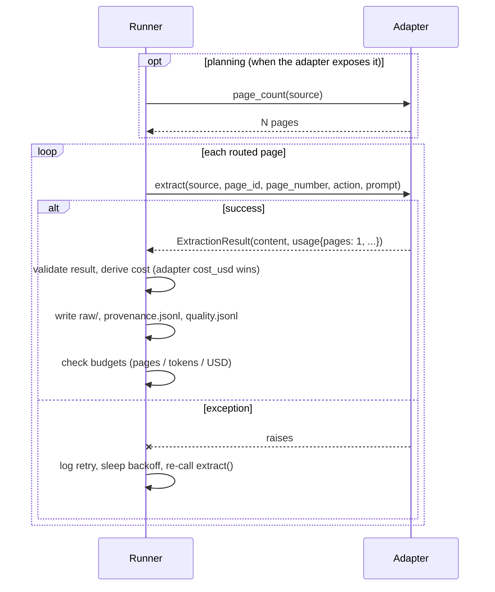

# Extractor adapter protocol

PageLedger calls existing OCR/VLM tools through a small adapter interface.
This keeps the package focused on routing, provenance, audit queues, and
rerun control.

The protocol is frozen for the 0.1 schema version. Releases may add optional
attributes; a new required attribute or a change to the `extract()` call waits
for a major release. See [stability](stability.md).

This document describes extraction adapters. Classifier hooks are a separate,
smaller protocol used only by `pageledger classify`; see
[`classifier.md`](classifier.md#classifier-hooks).

## Call sequence



Ordinary runs retry only when configured. Resumable runs and jobs
require zero automatic retries and stop after a failed or uncertain request.
See [checkpoint recovery](checkpoint-spec.md) and
[image input evidence](image-evidence-spec.md) for durable response handling.

## Write and check a small adapter

This complete example reads a text file whose pages are separated by form
feeds. Save it as
`toy_adapter.py` beside `pageledger.yml`. It uses the actual result type from
PageLedger, rather than defining a competing protocol type.

```python
from pathlib import Path
from typing import ClassVar

from pageledger.adapters import ExtractionResult, adapter_conformance_check


def toy_pages(source: Path) -> list[str]:
    # Decode the bytes as they are, so line endings stay as written; drop a
    # byte-order mark; a final form feed does not start an empty page.
    pages = source.read_bytes().decode("utf-8-sig").split("\f")
    if len(pages) > 1 and not pages[-1].strip():
        pages.pop()
    return pages


class ToyAdapter:
    name: ClassVar[str] = "toy"
    version: ClassVar[str] = "1"
    deterministic: ClassVar[bool] = True
    input_types: ClassVar[tuple[str, ...]] = ("text",)
    output_types: ClassVar[tuple[str, ...]] = ("text",)
    capabilities: ClassVar[tuple[str, ...]] = ("embedded_text", "local")

    def supports(self, action: str) -> bool:
        return action == "transcribe_text"

    def page_count(self, source: Path) -> int:
        return len(toy_pages(source))

    def extract(
        self,
        source: Path,
        *,
        page_id: str,
        page_number: int,
        action: str,
        prompt: str | None = None,
    ) -> ExtractionResult:
        if not self.supports(action):
            raise ValueError(f"Toy adapter does not support action: {action}")
        _ = page_id, prompt
        return ExtractionResult(
            content=toy_pages(source)[page_number - 1], format="text", confidence=None,
            model="toy-1", warnings=[], usage={"pages": 1},
        )


if __name__ == "__main__":
    issues = adapter_conformance_check(ToyAdapter())
    if issues:
        raise SystemExit("\n".join(issues))
    print("ToyAdapter conforms")
```

Run `python toy_adapter.py`; an empty issue list prints `ToyAdapter conforms`.
`toy_pages` splits pages the way the built-in `text` adapter (version 0.2) does.
Then configure the adapter in a complete config (the taxonomy is required):

```yaml
schema_version: "0.1"
taxonomy:
  page_types:
    prose:
      default_action: transcribe_text
run:
  adapter: toy_adapter:ToyAdapter
```

For `pages.txt`, containing one or more form-feed-separated pages, run
`pageledger run pages.txt --config pageledger.yml --out runs/toy
--adapter-path .`. A conformance check validates declared shape; it does not
prove extraction correctness. Add tests for supported actions, page numbering,
input handling, and failures. An image adapter follows the same one-call,
one-page contract: declare `input_types = ("image",)` and return
`usage={"pages": 1}` for each page.

A folder of page images is one multi-page source. An adapter whose
`input_types` include `"image"` but not `"pdf"` receives each page's own image
file as `source`, with `page_number` the page's place in the document (1 for a
single image file). Every other adapter receives a PDF carrier PageLedger wrote
for the run, in which page `page_number` holds that page's image; it is deleted
when the run ends, so do not keep its path. An adapter that renders pages can
call `pageledger.adapters.render_warnings(source, page_number, pixels=(width,
height))` with the size of its render; it returns `["render_upsampled"]` when
the render has more than 1.5 times the source image's pixels along the long
side, and works on carriers and scanned PDFs alike.

## Python protocol reference

```python
from dataclasses import dataclass
from pathlib import Path
from typing import Any, Sequence


@dataclass(frozen=True)
class ExtractionResult:
    """Serializable result returned by an extractor adapter."""
    content: str | dict[str, Any] | list[dict[str, Any]]
    format: str  # "text", "markdown", "json", "csv", "markdown_table"
    confidence: float | None
    model: str | None
    warnings: list[str]
    usage: dict[str, Any]  # {"pages": 1, "tokens": int|None, ...}
    confidence_detail: dict[str, Any] | None = None  # engine-native evidence
    input_evidence: dict[str, Any] | None = None  # exact page image descriptor
    layout: dict[str, Any] | None = None  # where the engine found the text


class ExtractorAdapter:
    """Protocol an adapter object must satisfy.

    All attributes are required for the 0.1 contract.  The conformance
    helper (pageledger.adapters.adapter_conformance_check) validates them.
    """
    name: str
    version: str
    deterministic: bool
    input_types: Sequence[str]      # e.g. ("text",), ("pdf",), ("image",)
    output_types: Sequence[str]     # e.g. ("text",), ("markdown", "json")
    capabilities: Sequence[str]     # e.g. "embedded_text", "ocr", "layout", "tables", "cloud", "local"

    def supports(self, action: str) -> bool:
        """Return True if this adapter can perform the route action."""

    def page_count(self, source: Path) -> int:
        """Optional. Return the source page count when the adapter can know it.
        Must return a positive integer.  Omit or leave absent to fall back
        to the generic paginator."""

    def extract(
        self,
        source: Path,
        *,
        page_id: str,
        page_number: int,
        action: str,
        prompt: str | None = None,
    ) -> ExtractionResult:
        """Extract one routed page.

        Called once per attempt for a page; configured retries may call it
        again after an exception. usage.pages MUST be 1: the canonical unit
        is the page, and each successful call handles one page.
        """
```

The run controller computes `prompt_hash` from the resolved prompt before
calling the adapter. Adapters receive the resolved prompt string; they should
not invent their own prompt hashes.

### Resumable execution

Resumable runs and jobs use the same adapter protocol. Resume reuses
saved responses without calling `extract()` again, but it still constructs
the adapter and checks its metadata, so constructors and page-count hooks must
not make extraction requests. Resumable execution needs zero automatic retries
and `on_page_error: stop`. Recovery cannot see retries made inside an adapter
or know whether a provider processed a request twice; if your adapter
retries, say so in its own documentation. The recovery rules are in the
[checkpoint specification](checkpoint-spec.md).

Use `pageledger.adapters.AdapterFailure(code, http_status=None,
partial_result=None)` for a typed terminal failure. Codes are
`MODEL_TIMEOUT`, `MODEL_HTTP_ERROR`, `MODEL_QUOTA`, `MODEL_OUTPUT_TRUNCATED`,
`MODEL_NETWORK_ERROR`, `MODEL_INVALID_RESPONSE`, `MODEL_EMPTY_RESPONSE`,
`MODEL_CONTENT_FILTERED`, `MODEL_RECITATION`,
`MODEL_UNAVAILABLE`, `IMAGE_RENDER_ERROR`, and `IMAGE_EVIDENCE_INVALID`.
`http_status` is an integer 100–599 or null. `partial_result` is an
`ExtractionResult` or null. Resumable runs and jobs validate a
partial result and keep it, with its usage, in the failure record; they never
complete or retry that page. A malformed partial result is discarded and the
failure is reported as `IMAGE_EVIDENCE_INVALID`. An ordinary run keeps no
partial result, and typed failures bypass its retries: use `--resumable` when
partial output must survive. Adapter messages and stdout/stderr are redacted;
failure codes and HTTP status do not prove a root cause.

Adapters must report the actual returned model and usage when available.
An optional `ExtractionResult.input_evidence` dictionary records an exact page
JPEG and its rendering/request identity; see
[`image-evidence-spec.md`](image-evidence-spec.md). It defaults to null, so old
adapters remain compatible.

An optional `ExtractionResult.layout` says where on the page the engine found
its text. It is a JSON object with exactly four keys:

```json
{"units": "page_millionths", "level": "line",
 "items": [{"box": [x0, y0, x1, y1], "text": "..."}],
 "source": {}}
```

Each `box` is four integers on a grid of 1,000,000 steps per page side, with
the origin at the top-left corner of the page as rendered (after its
`/Rotate`), `x` to the right and `y` downward, and `0 <= x0 < x1 <= 1000000`,
likewise for `y`. An engine that read a `pdftoppm` render divides its pixel
boxes by the render's width and height (`pageledger.layout.grid_box`). `level`
is `line` (a detector's text line) or `word` (an ALTO `String`); `text` is what
the engine read there and may be empty; `source` describes where the layout
came from and may be empty. `pageledger.layout.validate_layout` checks the
shape and a malformed layout fails the page. The run keeps the layout in the
page's recovery record and writes its digest to provenance as
`layout_sha256`; an adapter that declares `layout` in `capabilities` is one a
job may plan tiles from ([Read dense pages in tiles](processing-spec.md#read-dense-pages-in-tiles)).
`rapidocr` returns its line boxes and `alto` its word boxes. The field defaults
to null, so adapters that know nothing of layouts are unchanged.

An adapter that declares `page_tiles` can read a page as a set of tiles. A job
that tiles its stage passes the page's tile plan as the `tiles` constructor
option (`pageledger.tiling`; a configuration may not set it), with
`evidence_dir`; the adapter must also have an integer `max_image_side`
attribute, the size the plan was made for. It reads each planned box as its own
image and returns one reading with `page_tiles` image evidence
([image evidence](image-evidence-spec.md#page-tiles)). `vision` is the
built-in one.

## The `usage.pages` contract

`usage.pages` **must be exactly 1** for every `extract()` call. PageLedger
calls `extract()` once per page, so the page count is always known from the
runner side. An adapter that reports `usage.pages > 1` or `usage.pages == 0`
causes an `AdapterExecutionError`. This rule is enforced by the runner's
`_validate_extraction_result`.

`usage.tokens`, `usage.compute_seconds`, and `usage.cost_usd` remain optional
and may be `null`.

All result evidence must fit the artifact contract before PageLedger writes
raw output: `confidence` is finite and between 0 and 1, `model` is text or
null, warning items are strings, `confidence_detail` is a JSON-serializable
mapping or null, and numeric usage values are finite, non-negative numbers
rather than booleans. `NaN` and infinity are rejected at the adapter boundary.

Use `model` for the concrete runtime identity that could affect output, not
only a marketing model name. The built-in `pdf_text` adapter records the
installed pypdf version. The built-in `pdf_ocr` adapter records the Tesseract
and Poppler renderer versions plus the effective DPI and language selection.
Custom adapters should likewise include model/revision, renderer, and material
inference settings when the backend exposes them.

Adapters do **not** have to know dollar prices. Report `cost_usd` only if the
backend returns it directly (e.g. an OpenRouter-style gateway); otherwise leave
it `null` and PageLedger derives cost from configured unit rates
(`run.pricing.cost_per_page` / `cost_per_1k_tokens`), falling back to `null`
when no rate is known.

## Loading custom adapters

The built-in adapters are named `text`, `pdf_text`, `pdf_ocr`, `vision`,
`rapidocr`, `indra` and `alto`.
Project-specific OCR or VLM wrappers can be loaded with a Python import
string:

```yaml
run:
  adapter: my_project.adapters:TesseractCliAdapter
```

The object after `:` may be an adapter instance, an adapter class, or a
factory function. The resolved adapter is validated for required metadata
(`name`, `version`, `deterministic`, `input_types`, `output_types`,
`capabilities`) and required methods (`supports`, `extract`). Validation
errors include the config key path and expected type. PageLedger never invents
missing metadata: doing so would make provenance claims the adapter did not
make. Classes and factories are constructed once per execution.

If the adapter can count pages before extraction, expose `page_count(source)`
returning a positive integer. Without this hook, a text file is split at form
feeds and any other file, a PDF included, counts as one page. A dry run does
not load the adapter, so it plans one page per PDF for a custom adapter even
when the adapter has this hook.

### Adapter options

`run.adapter_options` is a mapping passed to the adapter constructor as
keyword arguments. It works for built-in adapters and for custom classes and
factories:

```yaml
run:
  adapter: pdf_ocr
  adapter_options:
    dpi: 400
    lang: eng+rus
```

An adapter that does not accept a given option fails config validation with
the offending keys named. Options used in a run are recorded in
`manifest.extractors[].options`. Import strings that resolve to an already
constructed *instance* cannot take options: pass a class or factory instead.

### Optional reproducibility profile

Adapters may expose a `reproducibility_profile()` hook. It is an evidence hook,
not a packaging or environment-management API. The hook must return exactly:

```python
{
    "materials": [
        {
            "kind": "binary" | "package" | "model" | "asset",
            "name": "tesseract",
            "version": "5.4.0",       # exact revision, not `latest`/`main`
            "sha256": "<64 lowercase hex characters>",
        }
    ]
}
```

`materials` may be empty. Each material has exactly the four string keys
`kind`, `name`, `version`, and `sha256`; kind is one of `binary`, `package`,
`model`, or `asset`, names and versions must be non-empty path-free strings,
and `(kind, name)` pairs are unique. The hook must return no paths, secrets,
credentials, tokens, arbitrary metadata, or mutable version aliases. PageLedger
adds the package/adapter/runtime envelope and a `profile_sha256` to the
manifest and bundle; it does not copy or install the named material.

The hook is optional. Its absence never blocks an ordinary `run` or `bundle`,
but a deterministic local adapter without a profile cannot establish the strict
material identity required for an `exact` verified replay: its bundle replays
as `evidence_compared`. A profile covers
only the materials the adapter declares, not every imported dependency or
their authenticity. Cloud adapters are evidence-compared because cloud
identity and service state are outside this contract. See the [replay
boundary](capabilities-and-limits.md#verified-replay-boundary); this feature is
not isolated from external software, credentials, services, or machine state.

### Finding the adapter module

The module in an import string must be importable. Instead of setting
PYTHONPATH, pass the directory with `--adapter-path`:

```bash
pageledger run scan.pdf --config custom.yml --out runs/custom \
  --adapter-path ./my_adapters
```

The directory is prepended to `sys.path` before the config is validated.
`rerun`, `process`, `resume` and `replay` accept the same flag.

A job, run or bundle records the import string of its adapter. When you
`resume` one or `replay` a bundle, PageLedger imports a custom adapter only
from the folder you pass with `--adapter-path`, and only an object defined in
that folder; it never runs code because a folder you received names it. So
pass `--adapter-path` only for code you have read or trust, and see
[jobs, runs and bundles you receive](share-and-cite.md#jobs-runs-and-bundles-you-receive).

### Usage and spending caps

An adapter that declares `local` in `capabilities` costs nothing to call again.
Any other adapter that leaves `usage.tokens` or `usage.cost_usd` null under a
`run.budget.max_tokens` or `max_usd` cap stops the run before the next request,
because the cap can no longer be checked (`run.budget.unknown_usage: continue`
reads on). Report usage whenever the backend gives it, and declare `local` only
for an adapter that sends nothing off the machine.

### Local Docling example

[`examples/docling_adapter.py`](../examples/docling_adapter.py) is a functional
adapter for the machine-level Docling CLI. Install Docling outside the project
environment so its ML stack does not become a PageLedger dependency:

```bash
uv tool install docling
docling --version
```

Select the custom adapter in config (the `--adapter` shortcut intentionally
accepts built-ins only):

```yaml
run:
  adapter: docling_adapter:DoclingAdapter
  adapter_options:
    pipeline: standard
```

```bash
pageledger run report.pdf --config pageledger.yml \
  --adapter-path ./examples --out runs/docling
```

The standard pipeline performs local OCR, layout analysis, and table
recognition. To run the example's local VLM pass, set `pipeline: vlm` and
`vlm_model: smoldocling`. The example never enables
Docling remote services or external plugins. Docling may download model assets
on first use, so prewarm it before an offline run.

Action support is pipeline-specific: standard mode accepts
`transcribe_text` and `extract_table`, while VLM mode additionally accepts
`vlm_table`. The example rejects route prompts because the Docling CLI command
does not apply them; this prevents provenance from hashing a prompt that had no
effect on extraction.

One adapter instance is shared by the run. Standard mode converts each source
document once, caches the structured result in memory, and derives one Markdown
artifact per PDF page. Its conversion compute time is amortized across the
source pages. VLM mode instead passes `--page-range N-N` and caches each
requested page, so a selective rerun does not process every page in the source.
`usage.pages` remains 1 for every extraction call, while provenance records the
Docling version, pipeline, local VLM preset when applicable, and batch mode.
Local VLM conversion is much slower and is intended for selected audit/rerun
pages, not as an automatic first pass over a large corpus. Every VLM result
carries `docling_vlm_uncalibrated`, ensuring generative OCR remains in the
review queue even when text-shape and character-volume signals look clean.

### Remaining limits

- Async extraction is not supported (the runner is synchronous).
- One effective adapter instance is shared across the whole run generation.
  With `run.adapter_order`, generation D selects entry D for every extracted
  page. The chain advances only when `pageledger rerun` creates generation
  D+1; PageLedger does not try later adapters as per-page fallbacks inside one
  generation.

## Classifier hook pointer

A domain classifier is configured independently from extraction:

```yaml
classify:
  hook: my_project.classifier:ArchiveClassifier
  hook_options:
    collection: census
```

The import string may resolve to an instance, class, or factory. A hook
declares non-empty `name`, `version`, and `page_types`, with optional `model`
and `prompt_hash`, and implements:

```python
def classify_page(
    self,
    *,
    page_id: str,
    page_number: int,
    source: Path,
    text: str,
    signals: dict[str, Any],
) -> ClassificationResult:
    ...
```

The hook replaces the built-in structural decision while receiving its
proposal as `signals["builtin_type"]`. It must return
`pageledger.classifier.ClassificationResult`; PageLedger validates the type,
declared page taxonomy, confidence range, reason, action, and prompt before it
writes the route map. Hook failures stop classification with page context.
Use `classifier_conformance_check` or the complete protocol and examples in
[`classifier.md`](classifier.md#classifier-hooks). This hook does not
implement `ExtractorAdapter` and is never called by `pageledger run`.

## Timeout and subprocess guidance

Adapters that shell out to external commands (e.g. `pdftoppm`, `tesseract`,
`docling`, `marker`, `surya`) must handle subprocess failures explicitly:

- Use `subprocess.run(..., timeout=...)` to avoid hanging indefinitely.
- Catch `subprocess.TimeoutExpired` and re-raise as an `AdapterExecutionError`
  or a descriptive `RuntimeError` so PageLedger can record the failure in
  `run.log`. The default stops the run; `run.on_page_error: continue` proceeds
  to the next page, subject to `max_consecutive_failures`.
- Capture `stdout` and `stderr` when the adapter needs them for local control
  flow, but do not expect PageLedger to persist their contents. Failure
  envelopes are fail-closed: they retain the exception class and whether
  stdout/stderr existed, replacing all adapter-controlled diagnostic text with
  `<redacted>`. This prevents provider and subprocess errors from becoming a
  credential-exfiltration path through `run.log` or terminal output.

Adapter options are durable evidence, not a secret channel: PageLedger copies
them into `config-snapshot.yml` and records non-empty options in the manifest.
Do not pass credentials through `run.adapter_options`; resolve them from the
adapter's external credential store or environment instead.

Example pattern:

```python
def extract(self, source, *, page_id, page_number, action, prompt=None):
    try:
        result = subprocess.run(
            ["tesseract", str(source), "stdout", "-l", "eng"],
            capture_output=True, text=True, timeout=30,
        )
        result.check_returncode()
    except subprocess.TimeoutExpired:
        raise RuntimeError(
            f"Tesseract timed out for {page_id} after 30s"
        ) from None
    return ExtractionResult(
        content=result.stdout,
        ...
    )
```

## Adapter conformance helper

Adapter authors can validate their adapter against the protocol contract:

```python
from pageledger.adapters import adapter_conformance_check

issues = adapter_conformance_check(my_adapter)
if issues:
    for issue in issues:
        print(f"  - {issue}")
```

The checker returns a list of conformance issues (empty = passes). It validates:
required attributes and their types, sequence item types, required methods, and
optional `page_count` callability. It does not call `extract()` or `supports()`; test those in the adapter project.

This function is importable from `pageledger.adapters` and has no dependencies
beyond the Python standard library.

## Result fields

Adapters should return `ExtractionResult` instances with:

| Field | Type | Meaning |
|---|---|---|
| `content` | string or object | Raw extracted content. |
| `format` | string | `markdown`, `json`, `csv`, `text`, or `markdown_table`. |
| `confidence` | number or null | Adapter confidence when available. Serialize null as JSON `null`. |
| `model` | string or null | Model or OCR engine identifier. |
| `warnings` | array | Non-fatal quality issues (empty list if none). Preserved in provenance and copied into `quality.jsonl`, so they affect grades and audit routing. |
| `usage` | object | **`pages` must be 1**; `tokens`, `compute_seconds`, `cost_usd` optional/nullable. |
| `confidence_detail` | object or null | Optional engine-native confidence data, adapter-defined shape; recorded into `quality.jsonl` verbatim. `pdf_ocr` fills Tesseract per-word statistics (`scale`, `word_count`, `mean`, `min`, `below_60_count`, `below_60_ratio`); `pdf_text` records why it judged a layer an earlier OCR (`ocr_text_layer`: the signals that fired, and the producer when it is one). |
| `input_evidence` | object or null | Optional exact page image descriptor; shape, file containment, hashes and dimensions follow [the image evidence contract](image-evidence-spec.md). |
| `layout` | object or null | Optional boxes of the page's lines or words on a 1,000,000-step grid (see above); hashed into provenance as `layout_sha256`. |

An adapter whose output a model generates, and so can contain text that is
not on the page, should declare `generative` in `capabilities`. Jobs
keep such a reading in review until another engine agrees with it; see
[Compare engines on a page](processing-spec.md#compare-engines-on-a-page).
PageLedger never infers the capability from an adapter's name.

## Adapter candidates

- Tesseract / pytesseract for cheap OCR fallback.
- Docling for PDF/document conversion.
- Marker for Markdown extraction.
- Surya for OCR/layout/table recognition.
- olmOCR for LLM-oriented PDF extraction.
- API VLMs through OpenAI-compatible clients.

Built-in adapters: `text`, `pdf_text` (through `pageledger[pdf]`), `pdf_ocr`
(through locally installed Poppler and Tesseract), and
[`vision`](vision-adapter.md), which sends page images to a local or hosted
vision model; `rapidocr` and `indra` for local OCR; and `alto`, which reads OCR
a library published as ALTO XML ([recipe](engine-recipes.md#alto-from-a-library-any-platform-no-engine)). Anything else is a custom adapter; the adapter contract matters
more than adapter breadth.

Runnable examples live in `examples/`:

- `tesseract_pdftoppm_adapter.py`: compatibility import for existing configs;
  new configs should use the built-in `pdf_ocr` adapter
- `docling_adapter.py`: machine-level standard or local-VLM Docling conversion,
  document-batched into page-level Markdown
- `cloud_vlm_adapter_skeleton.py`
- `prereform_normalizer_adapter.py`: OCR plus pre-1918 Russian orthography
  canonicalization, with the rewrite recorded as a result warning

For extraction options, see [OCR and VLM options](ocr-options.md).
